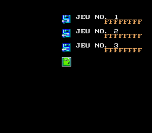
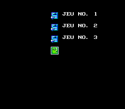
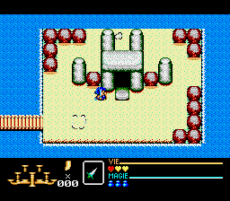

# V328 — noms SRAM et bordures vidéo, 2 Mo

Le retour utilisateur confirme que la V327 démarre jusqu'au jeu sur Mega Drive 1
avec flashkit 2 Mo + SRAM 32 Ko. Les deux vidéos suivantes montrent des noms
« FFFFFFFF » dans Continuer et des motifs répétés dans les marges haut/bas.
Les vidéos personnelles restent locales ; seules leurs empreintes figurent
dans le rapport public.

Deux défauts distincts sont traités :

- Les marqueurs de diagnostic remplissaient les plans avec la tuile 512.
  Cette tuile, vide au moment des marqueurs, est réutilisée par les graphismes
  du jeu. Les lignes des marges conservaient cette référence et affichaient
  alors les nouveaux motifs. La V328 retire les marqueurs et conserve
  VDP_init, la réinitialisation SGDK ayant permis le démarrage de la V327.
  Les marges retrouvent des entrées nulles et restent noires.
- Les noms SRAM n'étaient filtrés que sur leur premier octet (00 ou FF).
  D'autres octets non initialisés étaient envoyés à la police. Le cas FE
  reproduit les huit « F » dans la V327, via le glyphe de repli. La V328
  vérifie les huit caractères possibles du nom avec le jeu de caractères
  de création du personnage. Un nom invalide reste vide et son chargement
  est refusé. Aucun octet SRAM n'est effacé ou réécrit par cette validation.
  Le contenu réel de la SRAM du flashkit n'a pas été fourni : FE est un cas
  de reproduction contrôlé, pas une mesure de son contenu physique.

Un nom légitime « FFFFFFFF » reste autorisé. Ce filtre ne remplace pas
un contrôle d'intégrité complet du contenu d'une sauvegarde.

| Contrôle | Résultat logiciel |
| --- | --- |
| Démarrage, image, voix et fondus PAL/NTSC | Réussis |
| SRAM 00, FF, FE et mélangée, dans chaque région | Noms vides et chargement refusé |
| Quatre écrans de jeu par région | Marges de 16 pixels noires, tilemaps nulles |
| Sauvegarde valide existante, options Konami actives/inactives | Quatre chargements réussis |
| Menu Konami | Douze cas réussis |
| Campagnes enregistrées PAL et NTSC | Fin, neuf cristaux, zéro mort |
| Deux compilations | Binaire identique, 2 097 152 octets |

Les campagnes utilisent la protection d'approche déclarée, retirée avant les
combats contre les boss. Ces résultats ne constituent pas une nouvelle
certification à 100 % de la fidélité ou de tous les PNJ.

**V328 validée par l'utilisateur sur console le 13 novembre 2026.**
Cette acceptation fait suite à la demande de vérification du démarrage,
des emplacements de Continuer et des marges sur Mega Drive 1 avec flashkit
2 Mo + SRAM 32 Ko. [Confirmation matérielle](HARDWARE_ACCEPTANCE.json).
Elle ne constitue pas un parcours complet sur console ni une validation
matérielle des deux régions. Les rapports logiciels antérieurs sont conservés.
Le binaire est inchangé. Les deux alias ROM à la racine sont en V328.
Il n'y a plus d'écrans numérotés ni de pauses de diagnostic.

[Télécharger la V328](../../versions/v0328-368c003f/gaw-megadrive-v0328.bin)
· [Rapport et preuves](VALIDATION.json)

Reproduction de l'ancien défaut avec une SRAM synthétique FE :

Même cas dans la V328 :

Bordures du jeu dans la V328 :

