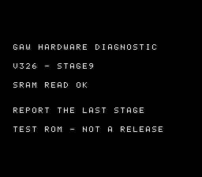

# V326 — diagnostic du démarrage sur flashkit

Le retour console confirme que la V325 présente toujours le splash et la voix,
puis un écran noir, sur Mega Drive 1 avec flashkit 2 Mo + SRAM 32 Ko.
La V322 RC1 démarre sur le même matériel. La correction de lecture hors cache
VDP est réelle, mais n'a pas résolu ce blocage matériel.

La V326 est **une ROM de diagnostic de 2 Mo**, pas une nouvelle RC.
Après le fondu, neuf écrans numérotés restent chacun visibles environ
1,5 seconde en NTSC et 1,8 seconde en PAL. Aucun bouton n'est nécessaire.
Une courte vidéo du démarrage permet de relever le dernier numéro affiché,
même si l'écran redevient noir ensuite. Si le jeu démarre avec cette ROM,
ce résultat est aussi utile : les pauses et les écritures vidéo de diagnostic
modifient volontairement le déroulement du démarrage.

| Étape | Point atteint |
| --- | --- |
| 1 | Fondu terminé, arrivée dans la sortie du splash |
| 2 | Effacement des plans effectué |
| 3 | FIFO vidéo vidé, bus Z80 relâché |
| 4 | Registres VDP restaurés |
| 5 | Retour au démarrage du jeu après restauration du registre d'état CPU |
| 6 | Initialisation audio du jeu terminée, avant l'attente d'interruption |
| 7 | Attente des interruptions vidéo terminée |
| 8 | Initialisation vidéo/manettes terminée, avant la lecture SRAM |
| 9 | Lecture SRAM terminée, avant l'introduction originale |

Il faut relever **le dernier numéro vu**, ou préciser qu'aucune étape
n'apparaît après le splash. La cause reste ouverte jusqu'à ce retour.
Le diagnostic ne remplace pas un test complet du jeu ; son rythme est
volontairement différent et ses glyphes utilisent temporairement la VRAM.



Les neuf numéros et leurs tilemaps sont vérifiés en PAL et NTSC ;
l'introduction originale est atteinte dans les deux cas, sans erreur
du moteur audio. Deux compilations produisent le même binaire.
La compilation sans `--diagnostic` reste exactement identique à la V325.
Les rapports de la V325 sont conservés comme résultats d'émulation historiques.
Les alias `gaw-megadrive.bin` et `gaw-title-megadrive.bin` restent en V325 ;
pour cet essai, utiliser expressément le fichier **gaw-megadrive-v0326.bin**.

[Télécharger la V326](../../versions/v0326-ed2ca443/gaw-megadrive-v0326.bin)
· [Validation du diagnostic](VALIDATION.json) · [Compilation](build.json)

Recompilation depuis la racine du projet :

```text
python tools/build_presentation_candidate.py --out validation/mon-diagnostic --diagnostic
python tools/validate_hardware_diagnostic.py --rom validation/mon-diagnostic/candidate.bin --out validation/ma-preuve
```
