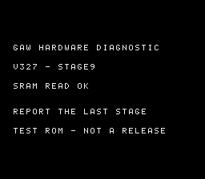

# V327 — sortie du splash après analyse vidéo

La vidéo de la V326 montre les étapes 1, 2 et 3. L'étape 3 « FIFO DRAINED »
reste visible jusqu'à environ 15,4 s ; l'image devient noire vers 15,6 s,
sans étape 4 visible avant la fin de la vidéo à 21,64 s.
Cela localise la perte d'affichage entre les marqueurs 3 et 4, sans démontrer
à elle seule que le CPU est bloqué plutôt que la vidéo ou la synchronisation.
L'empreinte du fichier est conservée dans le rapport ; la vidéo personnelle
et ses captures restent locales et ne sont pas publiées dans le dépôt.

Une erreur de l'instrumentation a aussi été trouvée : le diagnostic V326
rallumait l'affichage puis retournait dans une reconfiguration vidéo prévue
pour se dérouler écran éteint. La V327 éteint explicitement l'affichage
à la sortie des premières étapes et restaure la largeur avec l'affichage
coupé avant de reprendre le jeu aux étapes suivantes.

Le chemin expérimental de sortie du splash utilise maintenant **VDP_init**,
la routine SGDK d'origine déjà liée à l'adresse 0x3271c et utilisée dans
le démarrage de la V322, au lieu de restaurer manuellement le cache vidéo.
Cette routine reconstruit les registres, VRAM, palettes, défilements et
état SGDK. L'étape 4 devient « VDP INIT OK ».

**Ce binaire reste un diagnostic matériel de 2 Mo, pas une RC.**
Les neuf étapes et le retour à l'introduction sont vérifiés en émulation
PAL et NTSC. Deux compilations produisent le même SHA-256. La compilation
sans le mode diagnostic reste exactement identique à la V325 ; les alias
ROM à la racine du projet sont conservés en V325.

Pour le prochain essai, démarrer à froid sans appuyer sur une touche et
relever le dernier numéro visible, ou indiquer si l'introduction démarre.
Les écrans numérotés restent environ deux secondes chacun. Les pauses
modifient volontairement les timings ; aucun parcours complet du jeu
n'est qualifié pour ce binaire de diagnostic.

[Télécharger la V327](../../versions/v0327-781abfa9/gaw-megadrive-v0327.bin)
· [Rapport](VALIDATION.json) · [Compilation](build.json)

