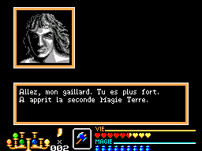
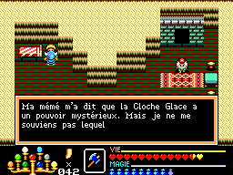
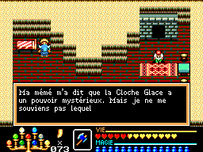

# Trois textes SMS — code, guide et jeu

Les chaînes DA58, DA7C et ED3C existent dans la ROM SMS fournie. Leurs octets exacts sont absents de la V321. Aucun locuteur des trois répliques n'est encore démontré.

## Repères du guide et vérifications

Le [guide d'Andrew Light](https://gamefaqs.gamespot.com/sms/588075-golden-axe-warrior/faqs/64050) situe Battler en D10, un informateur sur Terre niveau 2 en L10, et un habitant qui a oublié le pouvoir de la cloche dans la maison droite d'Aires, O15. Il n'attribue pas les trois répliques précises signalées. Ces correspondances thématiques servent de pistes, pas d'attributions certaines.

| Candidat | Essai SMS réellement effectué | Texte sélectionné |
| --- | --- | --- |
| Battler, D10 | Premier achat : Terre 0 → 1, 50 cornes débitées | B06F puis B35D |
| Battler, D10 | Amélioration : Terre 1 → 2, 100 cornes débitées | B233 puis B3E5 : « A apprit la seconde Magie Terre. » |
| Battler, D10 | Revisite avec Terre 2 | B333 : « Je n'ai plus rien à t'apprendre. » |
| Informateur L10 | Visite avec Terre 1, puis avec Terre 2 | 96EC dans les deux cas : indice sur les rochers cassables |
| Informateur L15 | Revisite avec Terre 2 et neuf cristaux | 99F1 : rumeur sur Death Adder, conforme au repère L15 du guide |
| Aires, maison droite, habitant à gauche | Cloche réellement sélectionnée puis sonnée dehors ; nouvelle conversation | A937 : il dit toujours ne pas se souvenir |
| Même habitant d'Aires | Après ouverture réelle du passage de Linda et apprentissage d'Eau | A937 également ; Eau 1 et drapeau AA ouvert sont contrôlés |

Huit scénarios ont été rejoués depuis le démarrage de la ROM. Les cinq visites nouvelles ont une relecture indépendante reproduisant les 8192 octets de RAM et l'image finale. Les trois relectures de Battler reproduisent aussi exactement ces états. Aucun objet, niveau de magie, argent ou état de quête n'est injecté ; la protection d'approche héritée reste déclarée. Pour Battler, l'adresse de retour et la position de pile distinguent la fin du message du retour interne après impression du nom du héros.

## Ce que sélectionne le code original

Dans la pièce 03 d'Aires, le script AD19–AD2E appelle deux fois le sélecteur ordinaire 667E. Pour le PNJ de gauche, la table AD38 contient FE 37 A9 : le texte est A937. Cette sélection dépend de l'emplacement du PNJ et de la provenance FE. Elle ne lit ni possession de cloche, ni utilisation de cloche, ni niveau d'Eau. Le code de ce PNJ ne sélectionne pas AD3C, adresse CPU du texte ED3C.

Battler utilise le niveau de Terre en C0E5, les prérequis de vie, la réponse et l'argent disponible. Sa routine 7A56–7AC7 et sa sortie commune sélectionnent B06F, B165, B225, B233, B333, B35D, B3E5, B3A0 ou 8BCD. Les deux adresses 9A58 et 9A7C n'appartiennent pas à ces choix. Le « second papier » semble désigner le second niveau de Terre ; cette interprétation ne prouve pas quel autre PNJ aurait dû commenter son acquisition.

Le voisin physique de DA58, en L15, parle de Death Adder. Le guide confirme ce sujet. L'emplacement d'une chaîne à la suite d'une autre dans la ROM ne lui attribue donc pas le même locuteur.

## Captures des nouvelles preuves

Après achat effectif de Terre niveau 2 :

Habitant d'Aires après avoir sonné la cloche :

Même habitant après Linda et Eau :

## Conclusion et limites

Les tests n'établissent pas de dialogue SMS déclenché qui manquerait sur MD pour ces trois phrases. Les candidats désignés par les thèmes du guide ont des répliques différentes, confirmées par leurs sélecteurs et par l'exécution. Les trois textes restent sans locuteur ni déclencheur démontrés ; leur inutilisation globale n'est pas affirmée. La ROM V321 reste inchangée.

Le cas Aires avant possession de la cloche n'a pas été joué ici. Les essais de contrôleur échoués et un état supplémentaire sans Eau restent des diagnostics, pas des preuves de conditions remplies.

[Données, octets de code, repères de guide et rapports d'exécution](PREUVES.json).
