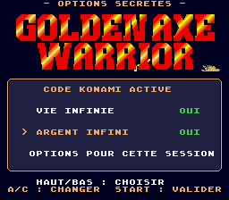

# V323 — menu secret Konami

ROM basée sur la V322 RC1, conservée sans modification. La V323 ajoute un menu
natif 68000 avec le logo original, un cadre doré, un panneau sombre et des valeurs
OUI/NON colorées.



## Utilisation

À l'écran titre, saisir : **Haut, Haut, Bas, Bas, Gauche, Droite, Gauche, Droite, B, A, Start**.
Relâcher chaque touche entre deux pressions, notamment les deux Haut et les deux Bas.

- Haut/Bas : choisir Vie infinie ou Argent infini.
- A ou C : activer/désactiver l'option sélectionnée. Gauche/Droite fonctionnent aussi.
- Start : valider et rejoindre Nouveau jeu / Continuer.

Les options commencent sur NON et restent actives pour la session jusqu'au Reset.
Vie infinie maintient la vie au maximum et rend le héros invulnérable.
Argent infini remet continuellement la bourse à **255**, plafond d'origine.
Les options ne font pas partie du format SRAM ; les ressources enregistrées par
une sauvegarde restent les ressources réellement possédées dans le jeu.

## Validation

- Deux compilations donnent exactement le même binaire de 2048 Kio ; checksum F0C3.
- Campagnes normales PAL et NTSC rejouées jusqu'au générique, neuf cristaux,
  zéro mort, options contrôlées désactivées à chaque image. Comme dans le parcours
  RC1, la protection des approches reste déclarée et retirée devant les boss.
- 12 essais de menu PAL/NTSC : code correct, erreur, touche tenue, quatre
  combinaisons d'options, bascule indépendante et retour vers Nouvelle partie.
- Une sauvegarde authentique V322 est chargée normalement par Continuer dans
  les deux régions, avec et sans les deux options. Objets, cristaux et statistiques
  vérifiés ; seuls PV/argent suivent les options lorsqu'elles sont activées.
- Contact réel avec les ennemis : 24 PV deviennent 20 PV sans option ; 24 PV restent 24
  avec Vie infinie pendant 234 images de chevauchement avec les ennemis.
- Six clés réellement achetées à 60 chacune, soit 360 au total, avec une bourse
  restant à 255. Rejeu indépendant : 65536 octets RAM et pixels finaux identiques.
- Les essais propres au menu, aux achats et aux contacts n'injectent aucune RAM.
  Les effets de triche proviennent du code de la cartouche.

[Validation et empreintes des preuves](VALIDATION.json).

SHA-256 : `9fcee16dc12028138712564ebd7123d99a25d1ef8f6e54d9799f02ceddaacd99`.
[ROM V323](../../versions/v0323-9fcee16d/gaw-megadrive-v0323.bin).
Il s'agit d'une extension validée sur émulateur ; elle ne reprend pas le label
RC1 ni une nouvelle certification de toutes les 329 annexes sur ce binaire.

## Recompiler

Avec Python et les outils SGDK, depuis la racine du dépôt :

```powershell
python tools/build_konami_candidate.py --out validation/rebuild-konami-v323 --sdk-bin ../../work/sgdk/bin
```

Le résultat est `validation/rebuild-konami-v323/candidate.bin`. Le script vérifie
la V322 RC1 archivée, compile l'extension C/assembleur et vérifie chaque site de
raccordement avant de calculer le checksum. Il conserve tous les autres octets.
L'option `--base` accepte aussi une V322 RC1 fraîchement reconstruite avec
`tools/build_rc_rom.py`, obligatoirement de même SHA-256.

L'extension réserve 32 octets avant le tas SGDK, décalé proprement ; les adresses
du jeu restent identiques. L'entrée de la reconnaissance se trouve uniquement
dans le parcours du titre. Les effets actifs utilisent un callback VBlank
installé à la validation du menu ; les fonctions du moteur ne sont pas remplacées.
