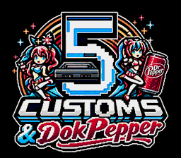

# V324 — présentation de démarrage, ROM de 2 Mo

La ROM reste à **2097152 octets (2048 Kio)**. L'image et la voix fournies sont
intégrées dans le remplissage inutilisé de la V323. Aucune réduction supplémentaire
de qualité n'a été nécessaire pour respecter cette taille.



L'image apparaît avec un fondu, la voix est jouée pendant environ 3,63 secondes,
puis un fondu vers le noir laisse place à l'introduction originale. Cette séquence
apparaît une fois par démarrage ou Reset. Le titre et le menu Konami restent disponibles.

[ROM V324](../../versions/v0324-f25581d6/gaw-megadrive-v0324.bin).
[Aperçu vidéo local avec le son réel](../../videos/v0324/README.md).

## Ressources et fonctionnement

L'image est adaptée au VDP : 256×224, 896 tuiles et quatre palettes de 16 couleurs,
sur fond noir, en conservant ses proportions. La voix fournie est convertie en
PCM 8 bits mono, jouée sur les deux sorties du DAC YM2612 par le 68000. Les variantes
PAL et NTSC conservent la durée et la hauteur de la voix. Le volume est normalisé
avec une marge avant saturation ; les extrémités sont adoucies contre les clics.

Le moteur, les ressources du jeu et l'extension Konami de la V323 sont conservés.
Le point d'entrée ajoute la présentation puis exécute le prologue original.
Les registres vidéo sont restaurés et l'époque de l'horloge du jeu est compensée
pour conserver le rythme original des acteurs. La plage 0x120000..0x1EFFFF était
remplie de FF : la nouvelle séquence utilise 145822 octets de cet espace.
Le format et les adresses SRAM restent inchangés.

## Vérifications

- Deux compilations donnent le même SHA-256 et le checksum **93E3**.
- Tuiles et carte vidéo chargées identiques aux ressources converties ; fondus
  d'entrée et de sortie contrôlés sur les captures réelles.
- Voix capturée comparée au PCM de référence : corrélation supérieure à 0,97,
  durée 3,63 secondes et absence de saturation numérique dans les deux régions.
- Campagnes normales NTSC et PAL rejouées jusqu'à la fin et au générique : neuf
  cristaux, zéro mort, zéro erreur audio et aucune protection pendant les combats
  de boss. La protection des approches autorisée antérieurement reste déclarée.
- 12 essais du menu Konami, dont ses options indépendantes et les codes incorrects.
- Quatre chargements réels par Continuer d'une sauvegarde authentique : PAL/NTSC,
  options activées et désactivées, statistiques/objets/cristaux et déplacement vérifiés.
- L'aperçu vidéo provient de l'émulation réelle. Un second processus repart à froid :
  les 65536 octets RAM, l'image finale et l'audio PCM sont strictement identiques.
  Le MP4 est intégralement décodé sans erreur et ses 650 images sont vérifiées.

[Validation et empreintes des preuves](VALIDATION.json).
Ces vérifications concernent l'émulateur et les parcours retenus ; elles ne constituent
pas une nouvelle certification globale 100 % de toutes les variantes du jeu ou du matériel.
La V322 RC1 et la V323 restent conservées dans les versions.

## Recompiler

Les ressources natives sont livrées dans `megadrive/presentation/`. Avec Python et
les outils SGDK :

```powershell
python tools/build_presentation_candidate.py --out validation/rebuild-presentation --sdk-bin ../../work/sgdk/bin
```

Le résultat est `validation/rebuild-presentation/candidate.bin`. Le script vérifie
la V323 archivée et chaque zone libre avant insertion. Pour régénérer les ressources,
avec Pillow, NumPy et imageio-ffmpeg installés :

```powershell
python tools/generate_presentation_assets.py --image megadrive/presentation/original.png --audio megadrive/presentation/voice.mp3
```

SHA-256 de la ROM : `f25581d62e0654fc85729affe9405b64a51603fc5ddce5965a89a6fdb27e3c31`.
