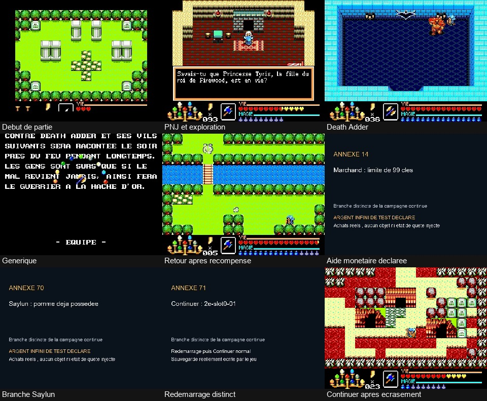

# Campagne SMS et annexes — 12 novembre 2026

Le MP4 local `gaw-sms-campagne-et-annexes.mp4` dure **4 h 26 min 57 s** et pèse
2 469 192 312 octets. Il reste sur la machine de travail ; il n'est pas inclus
dans Git. Aucun envoi sur YouTube n'est effectué.

La campagne continue va de la nouvelle partie au générique. Elle est suivie
de 70 branches de parcours et de 17 redémarrages par Continuer, annoncés par
87 cartons. Les branches couvrent les 145 preuves sélectionnées des points
3 et 4 SMS. Les deux tests avec argent infini sont signalés à l'écran ; les
achats restent ceux du jeu. Les redémarrages utilisent les sauvegardes
réellement écrites par le jeu, sans état synthétique ni savestate.

Les introductions sont passées par les commandes enregistrées. Certains
dialogues sont brefs : mettre la vidéo en pause pour lire le texte intégral.
Les extraits Continuer les plus courts s'arrêtent au premier état contrôlable ;
mettre en pause sur leur dernière image pour vérifier l'état rechargé.
Les [repères de lecture](LISEZ-MOI-ET-CHAPITRES.txt) sont fournis dans un fichier
texte ; les chapitres ne sont pas intégrés au conteneur MP4.

La validation porte sur les 959 779 images, le décodage complet audio/vidéo
et la synchronisation, avec un écart inférieur à une milliseconde.
Les 350 images aux deux extrémités des 175 segments sont identiques aux
images décodées des fichiers sources. Les images de jeu compressées sont
recopiées dans le montage.

La certification globale de tous les PNJ et de toutes les variantes reste
ouverte, ainsi que le déclencheur des textes DA58, DA7C et ED3C. Ce montage
documente le parcours retenu et ses annexes ; la validation MD reste distincte.

SHA-256 : `baf2a1655cacdb1c1cd7317b3139432bf3a87047c21d9b505760735bcf43ba6e`

[Rapport du montage](../../../analysis/sms_proof_montage_report.json) ·
[Vérification des raccords](../../../analysis/sms_montage_boundary_pixels_report.json) ·
[Index des annexes](../annexes-2026-11-11/README.md)

