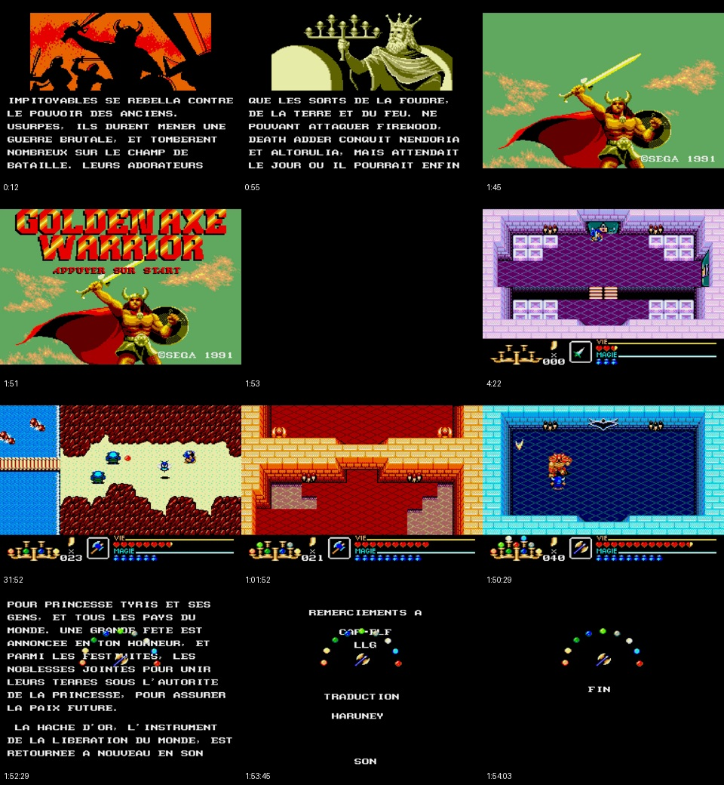

# Gameplay complet — V319 (développement)

Vidéo locale : `golden-axe-warrior-md-v0319-gameplay-complet-ntsc.mp4`.
Durée : **1 h 54 min 06 s**. 960×720, NTSC ~59,92 images/s, son stéréo AAC.
Taille : 1564288703 octets ; le MP4 reste hors Git.

SHA-256 : `ebf049475a5f92672cd7103066e2f6c3e58c16dbd2624cfd6635936bd34aa11e`.

Introduction et titre complets, puis parcours continu de nouvelle partie au
générique. Deux captures assemblées ; protection de test sur certaines approches,
retirée avant les combats de boss. Aucun import de vie, objets, progression ou
sauvegarde. Version de développement ; les nouveaux modules vidéo expérimentaux
ne sont pas encore activés dans cette ROM.

Le fichier final a ses 410213 images vérifiées et sa piste audio entièrement
décodée. La RAM et l’image finales de la campagne correspondent à la référence.
Cela ne certifie pas la fidélité complète à la SMS ou au matériel.

[Rapport](report.json) · [Titre YouTube](youtube-title.txt) · [Description et chapitres](youtube-description.txt).

Destination prévue : `@KennYMcCormick-m2b`, en visibilité **privée**.
L’utilisateur effectuera lui-même l’envoi du MP4 ; aucun envoi automatique.
Cette vidéo conserve le défaut de bordure du générique de la V319 : des lignes
peuvent apparaître dans les 16 pixels supplémentaires en bas de l’écran MD.

Recettes : `tools/record_v319_gameplay.py`, `tools/finalize_v319_gameplay_video.py`,
`tools/archive_v319_gameplay_video.py`. Dépendances : imageio-ffmpeg, OpenCV,
NumPy et Pillow. Captures fondées sur le parcours de validation déjà archivé.
